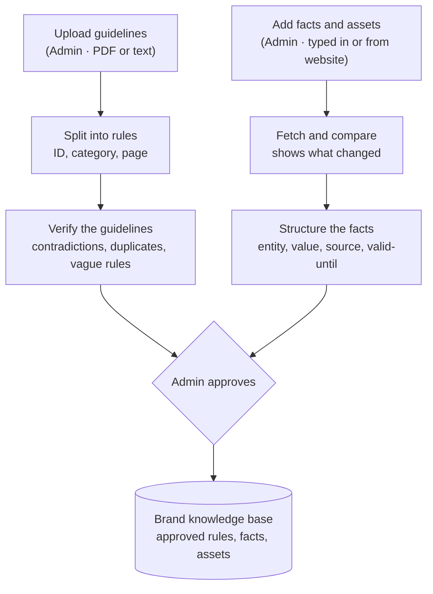
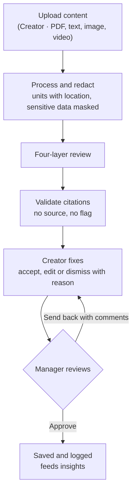
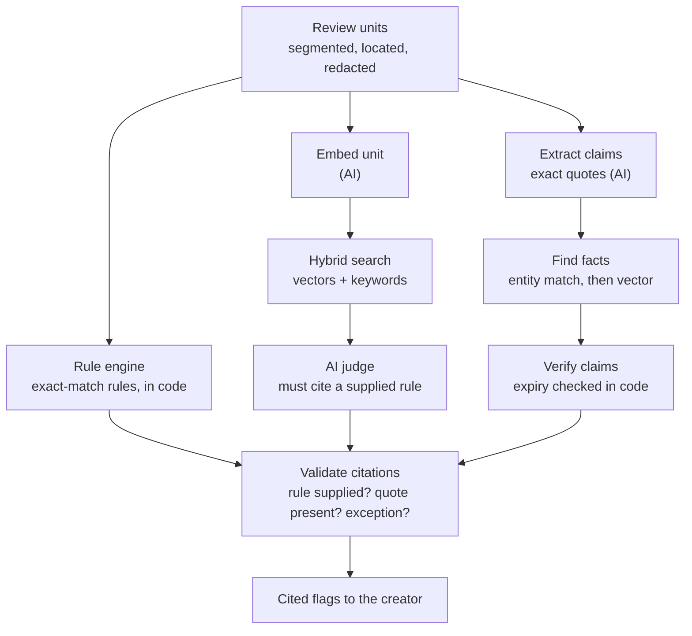
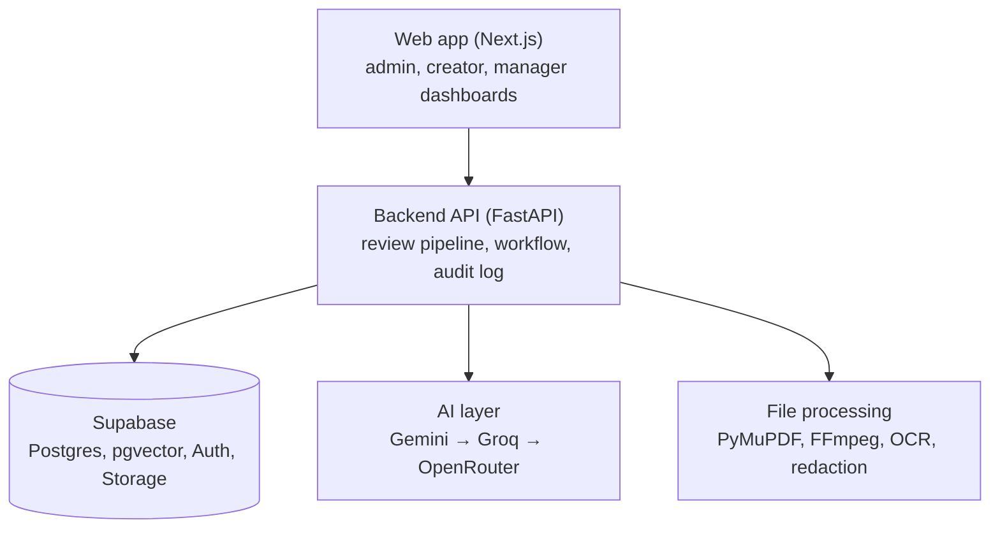

# Heimdall

**Nothing crosses unchecked.**

Heimdall is an AI brand-governance platform. It checks every piece of content against a brand's approved guidelines and facts *before* it is published, explains every issue it finds, cites the exact rule or fact behind it, and suggests a fix while leaving the final decision to people.

> **Status:** Round 1 (planning). The design below is agreed, and development starts in the official build window.
> Built by team **Nobita&Avaneja** for the Inkloom AI brand-governance problem statement.

---

## Table of contents

- [The problem](#the-problem)
- [Our solution](#our-solution)
- [Who uses it](#who-uses-it)
- [How it works](#how-it-works)
- [Features](#features)
- [Architecture](#architecture)
- [Tech stack](#tech-stack)
- [Project structure](#project-structure)
- [Getting started](#getting-started)
- [Roadmap](#roadmap)
- [Responsible AI](#responsible-ai)
- [Team](#team)
- [AI and tool disclosure](#ai-and-tool-disclosure)

---

## The problem

Growing organisations publish content through many employees, agencies and AI tools. No single person sees everything, so incorrect claims, outdated facts, inconsistent language, off-brand visuals and inaccessible content reach the public and damage credibility.

It keeps happening for three reasons:

1. **Rules live in documents.** Brand guidelines sit in long PDFs that people can't memorise and tools can't check against.
2. **Facts go out of date.** Prices, statistics and product names change, but old values live on in drafts and templates.
3. **Human review doesn't scale.** One brand manager can't read everything, and approvals leave no record of *why*.

### Why not just ask a chatbot?

A generic AI prompt can comment on tone, but it doesn't know the company's approved facts. It can invent rules or quotes, gives different answers on different runs, can't point to where an issue sits in a PDF or video, and keeps no roles, history or approvals. Heimdall uses AI only where judgement is needed, and checks every AI finding with plain code.

---

## Our solution

Heimdall sits between **"draft"** and **"publish"**:

- **Admins** upload brand guidelines (PDF or text). Heimdall splits them into individual rules and **checks the guidelines themselves** for contradictions, duplicates and vague wording before they're used. Approved facts can also be fetched from the company website and approved by the admin.
- **Creators** upload content as **PDF, text, image or video** and instantly see flagged issues in tone, terminology, facts, unsupported claims, visuals and accessibility. Every flag cites its source and comes with a suggested fix that keeps the creator's intent.
- **Managers** review only what's left, then approve the content or send it back with comments.
- Over time, Heimdall reports **recurring mistakes** and **guidelines that confuse people**.

### What makes it different

| Idea | What it means |
|---|---|
| **No source, no flag** | Code drops any AI finding that cites a rule it wasn't given, or quotes words that aren't in the content. |
| **We check the rulebook first** | Guidelines are verified for contradictions, duplicates, vague rules and missing areas before use. |
| **Facts have a shelf life** | Each approved fact has a source and a "valid until" date. Expired facts are caught automatically. |
| **One rule = one searchable unit** | Guidelines are split into individual rules, not fixed-size text chunks, so a flag can say "Rule R-012, page 4". |
| **Creators first, managers second** | Creators fix most issues before a manager looks. Approved exceptions are remembered. |
| **Guideline health** | Rules that reviewers keep dismissing are reported as probably unclear. |

---

## Who uses it

| Role | What they do in Heimdall |
|---|---|
| **Admin** (brand, legal or compliance lead) | Uploads guidelines, reviews problems found in them, approves rules, maintains facts and assets, reads insights. |
| **Creator** (employee, agency, freelancer) | Uploads drafts, sees cited flags, accepts, edits or dismisses suggested fixes, submits for approval. |
| **Manager** (brand or marketing manager) | Reviews remaining issues, approves or sends back with comments, approves exceptions with a reason. |

---

## How it works

### 1. Setup (when guidelines or facts change)



### 2. Review (for every piece of content)



### 3. The review engine (RAG)

Each upload is checked along three paths that all end in citation validation:



| Layer | What it checks | How |
|---|---|---|
| **(a) Rules** | Banned terms, required disclaimers, readability, alt text, colour contrast | Plain code: fast, free, consistent |
| **(b) Guidelines** | Tone, messaging, terminology | Hybrid retrieval of relevant rules + AI judge |
| **(c) Claims** | Prices, statistics, rankings, superlatives | Claim extraction + matching against approved facts |
| **(d) Visuals** | Logo versions, colour palette, off-brand imagery | Vision model against approved assets |

### Example

> **Draft:** "AcmeLearn is **India's No. 1 learning app**. Get Pro for just **₹499 a month**."
>
> | Quote | Issue | Source | Suggested fix |
> |---|---|---|---|
> | "India's No. 1 learning app" | Ranking claim with no approved fact | Rule R-012 (brand guide p. 4) | "Trusted by over 2 million learners" (Fact F-003) |
> | "₹499 a month" | Price doesn't match the approved fact | Fact F-007: Pro costs ₹599/month | "₹599 a month" |
>
> *AcmeLearn is a fictional brand; the rule and facts are sample data.*

### Flag format

Every flag, from any layer, uses the same structure. This is the contract between the review engine and the frontend:

```json
{
  "unit_id": "u3",
  "source_type": "rule",
  "source_id": "R-012",
  "category": "claims",
  "severity": "high",
  "evidence": "India's No. 1 learning app",
  "explanation": "Ranking claim with no approved supporting fact.",
  "suggested_fix": "Trusted by over 2 million learners",
  "confidence": 0.86,
  "location": { "paragraph": 1, "evidence_start": 13, "evidence_end": 39 },
  "layer": "claims"
}
```

---

## Features

| Feature | Round |
|---|---|
| Guideline import and verification (contradictions, duplicates, vague rules, gaps) | 2 |
| Fact store with sources and expiry dates | 2 |
| Four-layer review engine | 2 |
| Cited flags with suggested fixes | 2 |
| Review and approval workflow (roles, comments, send-back, revision history) | 2 |
| Approved exceptions that are remembered | 2 |
| Redaction before AI calls, and AI disclosure labels | 2 |
| Review of text, PDF and images | 2 |
| Short video review (transcript, frames, on-screen text, timestamped flags) | 3 |
| Website fact import with admin approval | 3 |
| Asset library (logos, disclaimers, templates) | 3 |
| Insights dashboard and guideline health | 3 |

---

## Architecture



- The web app talks only to the backend.
- **All AI calls go through one provider-agnostic layer** with automatic fallback (Gemini, then Groq, then OpenRouter) and a result cache, so rate limits don't stop a review.
- Rules and facts live in Postgres with **pgvector** for semantic search and Postgres full-text search for keywords, merged by reciprocal rank fusion.

---

## Tech stack

| Layer | Tools |
|---|---|
| Frontend | Next.js (React), Tailwind CSS, shadcn/ui, Recharts |
| Backend | FastAPI (Python), Pydantic |
| Database, auth, storage | Supabase (PostgreSQL, pgvector, Auth, Storage) |
| AI models | Google Gemini API (main model + embeddings), Groq (Whisper speech-to-text, Llama fallback), OpenRouter (secondary fallback) |
| Rule checks | Python regex, textstat, WCAG contrast formula |
| Privacy | Microsoft Presidio + spaCy |
| Files | PyMuPDF (PDF), FFmpeg (video frames), Tesseract / EasyOCR (on-screen text) |
| Website import | Playwright, BeautifulSoup, difflib |
| Hosting | Vercel (frontend), Render or Railway (backend) |

---

## Project structure

```
heimdall/
├── frontend/              # Next.js app: admin, creator and manager dashboards
├── backend/
│   ├── app/
│   │   ├── api/           # FastAPI routes
│   │   ├── review/        # four-layer review engine
│   │   ├── rag/           # rule extraction, embeddings, hybrid retrieval
│   │   ├── llm/           # provider-agnostic AI layer (fallback + cache)
│   │   ├── processing/    # PDF, image and video processing, redaction
│   │   └── models/        # Pydantic schemas (incl. the flag format)
│   └── tests/
├── db/
│   └── schema.sql         # Postgres + pgvector schema
├── test-data/             # fictional brands and planted-error test content
├── docs/                  # Round 1 plan, build log, architecture notes
├── .github/workflows/     # CI: ruff + pytest, lint + typecheck
└── README.md
```

Parts are added milestone by milestone (see `TASKS.md`); folders for later milestones may still be empty.

---

## Getting started

You will need:

- Node.js 20+ and Python 3.11 or 3.12
- A Supabase project with the `vector` extension enabled
- API keys for Gemini (required), and optionally Groq and OpenRouter

**Backend** (FastAPI, http://localhost:8000):

```bash
cd backend
python3.12 -m venv .venv
.venv/bin/pip install -e ".[dev]"
cp .env.example .env          # then fill in the values
.venv/bin/uvicorn app.main:app --reload
.venv/bin/pytest              # tests
.venv/bin/ruff check . && .venv/bin/ruff format --check .
```

**Frontend** (Next.js, http://localhost:3000):

```bash
cd frontend
npm install
cp .env.example .env.local    # then fill in the values
npm run dev
npm run lint && npm run typecheck
```

Every variable is listed, with empty values, in `backend/.env.example` and `frontend/.env.example`.

> Never commit `.env` or `.env.local` files or API keys. Only the `.env.example` templates are committed, and they stay empty.

### Branches

`main` always builds and passes CI. Each feature is built on its own branch (`feature/m2-database`, `feature/m3-ai-layer`, …), one commit per task (`2.1: database schema`), and merged into `main` with a merge commit once its tasks are done and CI is green. Fixes use `fix/<topic>`, documentation `docs/<topic>`, tooling `chore/<topic>`. Merged branches are deleted.

---

## Roadmap

### Round 1 · The Plan
- [x] Problem understanding, users and solution
- [x] Workflow, architecture and tech stack
- [x] Development plan and team roles
- [ ] Design the planted-error test set

### Round 2 · The Build
- [ ] Core loop for text: guidelines → rules → review → cited flags → approval
- [ ] Claim checks and guideline verification
- [ ] PDF and image support with visual checks
- [ ] Roles, comments, send-back, revision history
- [ ] Redaction and AI disclosure
- [ ] Test-set run and user testing

### Round 3 · The Finish (three named improvements)
- [ ] Short video review with timestamped flags
- [ ] Website fact import with admin approval, plus the asset library
- [ ] Insights and guideline health, with accuracy gains measured on the same test set

### Success targets (for our own testing)
| Measure | Round 2 | Round 3 |
|---|---|---|
| Planted errors caught | ≥ 75% | ≥ 85% |
| Flags that are correct | ≥ 75% | ≥ 85% |
| Flags shown without a valid source | 0 | 0 |
| Time to first feedback (one-page document) | < 60 s | < 60 s |

---

## Responsible AI

- **Human control:** the AI only advises. It never publishes or blocks content, and every override is logged with a reason.
- **Confidentiality:** sensitive details are masked before any AI call, and only the excerpt being checked is sent. During the event we use **fictional brands and sample content only**, because free AI tiers may use submitted data to improve their products.
- **Transparency:** every flag shows its source, every AI suggestion is labelled, and the AI service used for each check is recorded.
- **Accessibility:** Heimdall checks alt text, contrast and captions, and its own interface follows the same standards.

---

## Team

**Team Nobita&Avaneja**, Newton School of Technology, Rishihood University

| Member | Role | Focus |
|---|---|---|
| **Aayush Ruparelia** | AI and ML lead, co-backend developer | RAG pipeline, review agent, guideline and claim verification, AI layer, redaction, prompts, accuracy testing; FastAPI services, database schema, website import |
| **Avaneja Rikhta** | Frontend developer, product and QA lead, co-backend and AI developer | Dashboards, flag and review screens, insights charts, accessibility; test content, user testing, documentation, demo; prompt testing and file processing |

---

## AI and tool disclosure

- Planning documents and parts of this README were drafted with help from an AI assistant (Claude, by Anthropic).
- The product uses the Gemini, Groq and OpenRouter APIs and the open-source libraries listed above, each under its own licence.
- Every template, library and AI coding tool used during the build will be listed here and in our Round 2 and Round 3 submissions.
