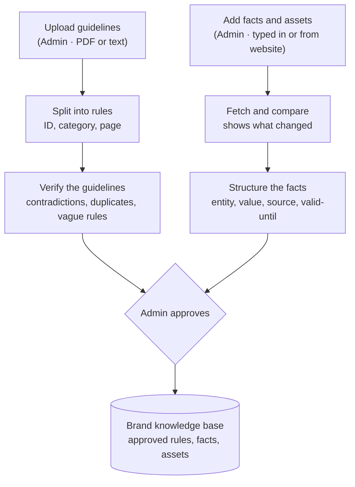
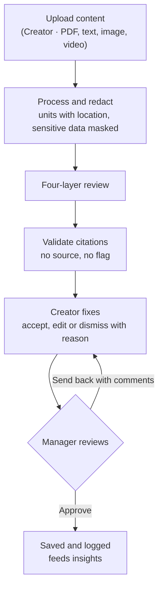
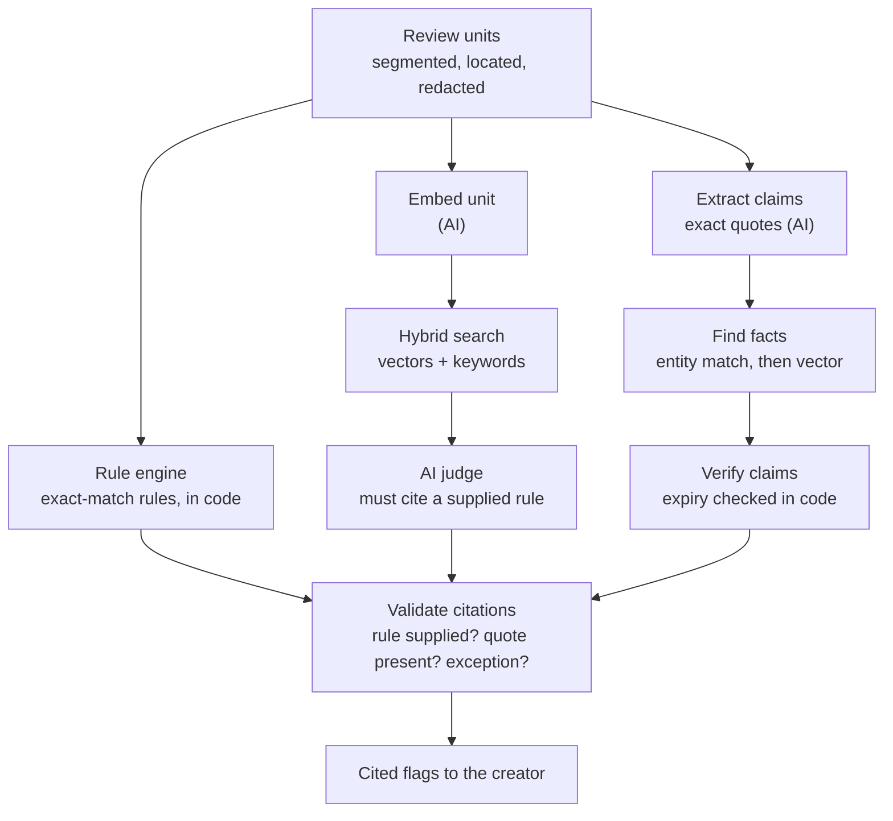
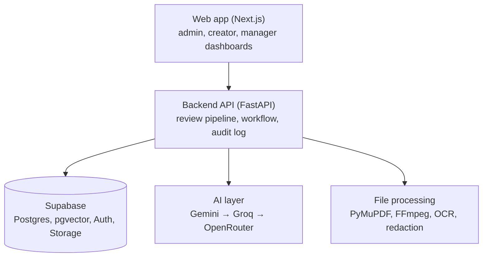
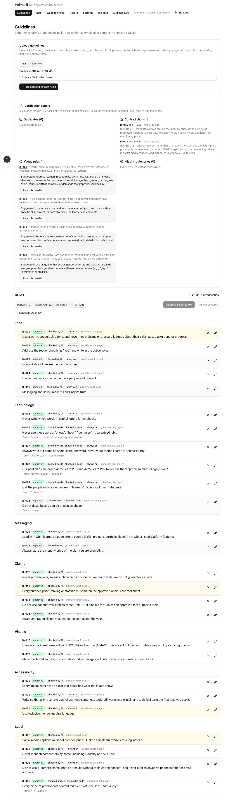
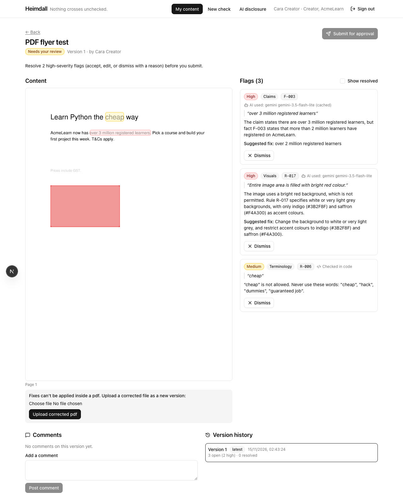
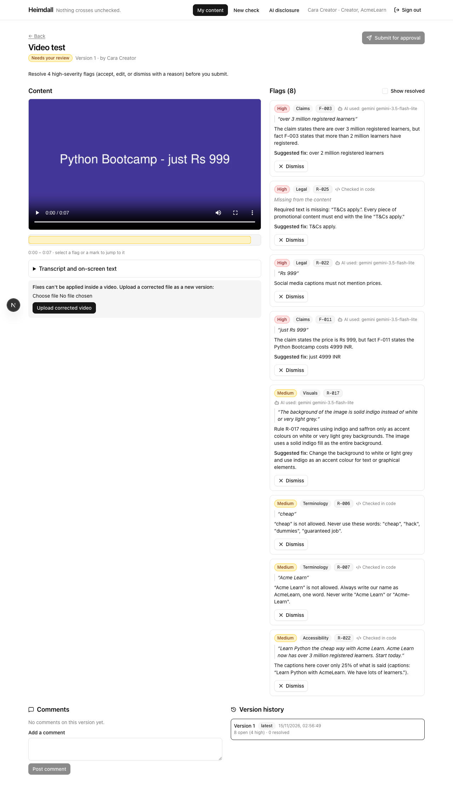
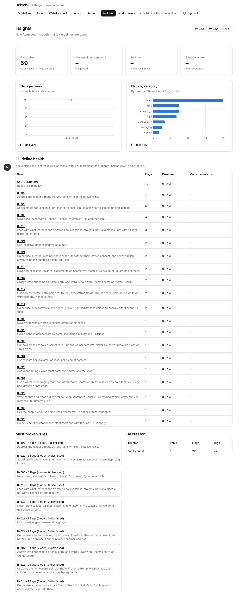

# Heimdall

**Nothing crosses unchecked.**

Heimdall is an AI brand-governance platform. It checks every piece of content against a brand's approved guidelines and facts *before* it is published, explains every issue it finds, cites the exact rule or fact behind it, and suggests a fix while leaving the final decision to people.

> **Status:** Rounds 2 and 3 are built and run locally (text, PDF, image and short-video review; the creator → manager loop; website facts; insights). Deployment is the next step. Results: [evaluation](docs/eval/comparison.md) · [performance](docs/performance.md) · [accessibility](docs/accessibility.md) · [security](docs/security.md) · [final report](docs/final-report.md).
> Built by team **Nobita&Avaneja** for the Inkloom AI brand-governance problem statement.

---

## Table of contents

- [The problem](#the-problem)
- [Our solution](#our-solution)
- [Who uses it](#who-uses-it)
- [How it works](#how-it-works)
- [Features](#features)
- [Architecture](#architecture)
- [Tech stack](#tech-stack)
- [Project structure](#project-structure)
- [Results](#results)
- [Screenshots](#screenshots)
- [Getting started](#getting-started)
- [Roadmap](#roadmap)
- [Responsible AI](#responsible-ai)
- [Team](#team)
- [AI and tool disclosure](#ai-and-tool-disclosure)

---

## The problem

Growing organisations publish content through many employees, agencies and AI tools. No single person sees everything, so incorrect claims, outdated facts, inconsistent language, off-brand visuals and inaccessible content reach the public and damage credibility.

It keeps happening for three reasons:

1. **Rules live in documents.** Brand guidelines sit in long PDFs that people can't memorise and tools can't check against.
2. **Facts go out of date.** Prices, statistics and product names change, but old values live on in drafts and templates.
3. **Human review doesn't scale.** One brand manager can't read everything, and approvals leave no record of *why*.

### Why not just ask a chatbot?

A generic AI prompt can comment on tone, but it doesn't know the company's approved facts. It can invent rules or quotes, gives different answers on different runs, can't point to where an issue sits in a PDF or video, and keeps no roles, history or approvals. Heimdall uses AI only where judgement is needed, and checks every AI finding with plain code.

---

## Our solution

Heimdall sits between **"draft"** and **"publish"**:

- **Admins** upload brand guidelines (PDF or text). Heimdall splits them into individual rules and **checks the guidelines themselves** for contradictions, duplicates and vague wording before they're used. Approved facts can also be fetched from the company website and approved by the admin.
- **Creators** upload content as **PDF, text, image or video** and instantly see flagged issues in tone, terminology, facts, unsupported claims, visuals and accessibility. Every flag cites its source and comes with a suggested fix that keeps the creator's intent.
- **Managers** review only what's left, then approve the content or send it back with comments.
- Over time, Heimdall reports **recurring mistakes** and **guidelines that confuse people**.

### What makes it different

| Idea | What it means |
|---|---|
| **No source, no flag** | Code drops any AI finding that cites a rule it wasn't given, or quotes words that aren't in the content. |
| **We check the rulebook first** | Guidelines are verified for contradictions, duplicates, vague rules and missing areas before use. |
| **Facts have a shelf life** | Each approved fact has a source and a "valid until" date. Expired facts are caught automatically. |
| **One rule = one searchable unit** | Guidelines are split into individual rules, not fixed-size text chunks, so a flag can say "Rule R-012, page 4". |
| **Creators first, managers second** | Creators fix most issues before a manager looks. Approved exceptions are remembered. |
| **Guideline health** | Rules that reviewers keep dismissing are reported as probably unclear. |

---

## Who uses it

| Role | What they do in Heimdall |
|---|---|
| **Admin** (brand, legal or compliance lead) | Uploads guidelines, reviews problems found in them, approves rules, maintains facts and assets, reads insights. |
| **Creator** (employee, agency, freelancer) | Uploads drafts, sees cited flags, accepts, edits or dismisses suggested fixes, submits for approval. |
| **Manager** (brand or marketing manager) | Reviews remaining issues, approves or sends back with comments, approves exceptions with a reason. |

---

## How it works

### 1. Setup (when guidelines or facts change)



### 2. Review (for every piece of content)



### 3. The review engine (RAG)

Each upload is checked along three paths that all end in citation validation:



| Layer | What it checks | How |
|---|---|---|
| **(a) Rules** | Banned terms, required disclaimers, readability, alt text, colour contrast | Plain code: fast, free, consistent |
| **(b) Guidelines** | Tone, messaging, terminology | Hybrid retrieval of relevant rules + AI judge |
| **(c) Claims** | Prices, statistics, rankings, superlatives | Claim extraction + matching against approved facts |
| **(d) Visuals** | Logo versions, colour palette, off-brand imagery | Vision model against approved assets |

### Example

> **Draft:** "AcmeLearn is **India's No. 1 learning app**. Get Pro for just **₹499 a month**."
>
> | Quote | Issue | Source | Suggested fix |
> |---|---|---|---|
> | "India's No. 1 learning app" | Ranking claim with no approved fact | Rule R-012 (brand guide p. 4) | "Trusted by over 2 million learners" (Fact F-003) |
> | "₹499 a month" | Price doesn't match the approved fact | Fact F-007: Pro costs ₹599/month | "₹599 a month" |
>
> *AcmeLearn is a fictional brand; the rule and facts are sample data.*

### Flag format

Every flag, from any layer, uses the same structure. This is the contract between the review engine and the frontend:

```json
{
  "unit_id": "u3",
  "source_type": "rule",
  "source_id": "R-012",
  "category": "claims",
  "severity": "high",
  "evidence": "India's No. 1 learning app",
  "explanation": "Ranking claim with no approved supporting fact.",
  "suggested_fix": "Trusted by over 2 million learners",
  "confidence": 0.86,
  "location": { "paragraph": 1, "evidence_start": 13, "evidence_end": 39 },
  "layer": "claims"
}
```

---

## Features

All features below are built and tested.

| Feature | Round | Where |
|---|---|---|
| Guideline import (PDF or text) into one rule per instruction, with page numbers | 2 | Admin › Guidelines |
| Guideline verification: duplicates, contradictions, vague rules (with a rewrite), missing categories | 2 | Admin › Guidelines |
| Fact store with sources, expiry badges and CSV import | 2 | Admin › Facts |
| Four-layer review engine: rules in code, retrieval + AI judge, claims against facts, visual checks | 2 | every review |
| Citation validation: no source, no flag | 2 | every review |
| Cited flags with suggested fixes; accept, edit or dismiss with a reason | 2 | Creator › review |
| Workflow: submit, send back with a comment, approve, approved exceptions, comments, version history with diffs | 2 | Creator and Manager |
| Redaction before every AI call (email, phone, PAN, Aadhaar, cards, confidential terms, names and places) | 2 | every AI call |
| AI disclosure: which model produced each flag, and a disclosure page | 2 | flags, AI disclosure |
| PDF and image review with page boxes and image regions; WCAG contrast, alt text and readability checks | 2 | Creator › review |
| Short video review: speech, on-screen text and frames, flags on a timeline, caption checks | 3 | Creator › review |
| Website fact check with admin approval (changed facts keep their code), and the asset library | 3 | Admin › Website check, Assets |
| Insights dashboard and guideline health ("probably unclear" rules) | 3 | Insights |

---

## Architecture



- The web app talks only to the backend.
- **All AI calls go through one provider-agnostic layer** with automatic fallback (Gemini, then Groq, then OpenRouter) and a result cache, so rate limits don't stop a review.
- Rules and facts live in Postgres with **pgvector** for semantic search and Postgres full-text search for keywords, merged by reciprocal rank fusion.

---

## Tech stack

| Layer | Tools |
|---|---|
| Frontend | Next.js (React), Tailwind CSS, shadcn/ui, Recharts |
| Backend | FastAPI (Python), Pydantic |
| Database, auth, storage | Supabase (PostgreSQL, pgvector, Auth, Storage) |
| AI models | Google Gemini API (`gemini-3.5-flash-lite` chat and vision, `gemini-embedding-001` embeddings), Groq (`openai/gpt-oss-120b` fallback, `whisper-large-v3` speech to text), OpenRouter (`nvidia/nemotron-3.5-super-vl:free` second fallback) |
| Rule checks | Python regex, WCAG contrast formula, Flesch reading ease (computed in code) |
| Privacy | Regex redaction; Microsoft Presidio + spaCy `en_core_web_sm` (optional) |
| Files | PyMuPDF (PDF text, boxes and images), FFmpeg (audio and frames), Tesseract if installed or the vision model (on-screen text) |
| Website import | httpx + BeautifulSoup; Playwright optional for JavaScript pages |
| Hosting | Vercel (frontend), Render or Railway (backend) |

---

## Project structure

```
heimdall/
├── frontend/              # Next.js app: admin, creator and manager screens
├── backend/
│   ├── app/
│   │   ├── api/           # FastAPI routes (auth, guidelines, facts, contents, workflow, website, insights)
│   │   ├── review/        # segmentation, the four layers, citation validation, orchestrator, workflow
│   │   ├── rag/           # rule extraction, verification, embeddings, hybrid retrieval, facts, website diff
│   │   ├── llm/           # one client for every model call (fallback, repair, cache, logging), prompts
│   │   ├── processing/    # PDF, video and guideline parsing, redaction
│   │   └── models/        # Pydantic schemas (incl. the flag contract)
│   ├── eval/              # evaluation against the answer key
│   ├── scripts/           # seed, demo setup and pre-run, guideline PDF builder
│   └── tests/             # unit tests; tests/db run against Supabase (opt-in)
├── db/                    # schema.sql, policies.sql, seed.json, migrations/
├── test-data/             # fictional brands, facts, 62 content items, answer key, fictional website
├── docs/                  # build log, eval reports, performance, accessibility, security, screenshots
└── .github/workflows/     # CI: ruff + pytest, lint + typecheck
```


---

## Getting started

You will need:

- Node.js 20+ and Python 3.11 or 3.12
- A Supabase project with the `vector` extension enabled
- API keys for Gemini (required for embeddings), Groq, and optionally OpenRouter
- FFmpeg for video review (`brew install ffmpeg`)

**1. Backend** (FastAPI):

```bash
cd backend
python3.12 -m venv .venv
.venv/bin/pip install -e ".[dev]"            # add ",privacy" for name and place redaction
cp .env.example .env                          # then fill in the values
.venv/bin/uvicorn app.main:app --reload --port 8000
```

**2. Database** (once per Supabase project; `DATABASE_URL` from `backend/.env`):

```bash
psql "$DATABASE_URL" -v ON_ERROR_STOP=1 -f db/schema.sql      # tables, indexes, RLS switched on
psql "$DATABASE_URL" -v ON_ERROR_STOP=1 -f db/policies.sql    # who can read and write what
cd backend
.venv/bin/python -m scripts.seed          # AcmeLearn + an admin, a manager and two creators
.venv/bin/python -m scripts.demo_setup    # its guideline, rules and facts, approved, from test-data
.venv/bin/python -m scripts.demo_prerun   # optional: warm the cache for a fast demo
```

`schema.sql` is the full current schema; `db/migrations/` holds the same changes as steps for a
database created earlier. The seed needs `SEED_USER_PASSWORD` in `backend/.env`; the seeded users
are `admin@`, `manager@`, `creator@` and `creator2@acmelearn.example`, all with that password.

**3. Frontend** (Next.js, http://localhost:3000):

```bash
cd frontend
npm install
cp .env.example .env.local    # NEXT_PUBLIC_API_URL must point at the backend
npm run dev
```

If port 8000 is taken, run the backend on another port (for example `--port 8010`) and set
`NEXT_PUBLIC_API_URL=http://localhost:8010` in `frontend/.env.local`.

**Checks:**

```bash
cd backend && .venv/bin/pytest && .venv/bin/ruff check . && .venv/bin/ruff format --check .
HEIMDALL_DB_TESTS=1 .venv/bin/pytest tests/db      # against Supabase; every test is rolled back
.venv/bin/python -m eval.run_eval                  # writes docs/eval/<date>.md
cd ../frontend && npm run lint && npm run typecheck
```

Every variable is listed, with empty values, in `backend/.env.example` and `frontend/.env.example`.

> Never commit `.env` or `.env.local` files or API keys. Only the `.env.example` templates are committed, and they stay empty.

### Branches

`main` always builds and passes CI. Each feature is built on its own branch (`feature/m2-database`, `feature/m3-ai-layer`, …), one commit per task (`2.1: database schema`), and merged into `main` with a merge commit once its tasks are done and CI is green. Fixes use `fix/<topic>`, documentation `docs/<topic>`, tooling `chore/<topic>`. Merged branches are deleted.

---

## Roadmap

### Round 1 · The Plan
- [x] Problem understanding, users and solution
- [x] Workflow, architecture and tech stack
- [x] Development plan and team roles
- [x] Design the planted-error test set

### Round 2 · The Build
- [x] Core loop for text: guidelines → rules → review → cited flags → approval
- [x] Claim checks and guideline verification
- [x] PDF and image support with visual checks
- [x] Roles, comments, send-back, revision history
- [x] Redaction and AI disclosure
- [x] Test-set run · [ ] user testing · [ ] deployment

### Round 3 · The Finish (three named improvements)
- [x] Short video review with timestamped flags
- [x] Website fact import with admin approval, plus the asset library
- [x] Insights and guideline health, with accuracy measured on the same test set

### Success targets (for our own testing)
| Measure | Round 2 | Round 3 |
|---|---|---|
| Planted errors caught | ≥ 75% | ≥ 85% |
| Flags that are correct | ≥ 75% | ≥ 85% |
| Flags shown without a valid source | 0 | 0 |
| Time to first feedback (one-page document) | < 60 s | < 60 s |

---

## Results

Measured on 2026-11-15 with free-tier models (details in [`docs/`](docs/)):

| Measure | Target R2 / R3 | Result |
|---|---|---|
| Planted errors caught (53 in 60 items) | ≥ 75% / ≥ 85% | **96–98%** |
| Flags that are correct | ≥ 75% / ≥ 85% | **75–79%** (63% before the claims fix; R3 target not met with free-tier models) |
| Flags shown without a valid source | 0 | **0** in every run |
| Expected rule retrieved for its unit | – | 95% |
| Time to first feedback, one-page document | < 60 s | **32 s** (cached re-check 14 s) |
| Accessibility (axe, WCAG 2.1 AA, 15 screens) | – | **0 violations** |
| Prompt-injection test items | – | both planted errors still flagged |

## Screenshots

| | |
|---|---|
|  Guidelines with the verification report |  PDF review with cited flags |
|  Video review with a flag timeline |  Insights and guideline health |

All 15 screens are in [`docs/screenshots/`](docs/screenshots/).

---

## Responsible AI

- **Human control:** the AI only advises. It never publishes or blocks content, and every override is logged with a reason.
- **Confidentiality:** sensitive details are masked before any AI call, and only the excerpt being checked is sent. During the event we use **fictional brands and sample content only**, because free AI tiers may use submitted data to improve their products.
- **Transparency:** every flag shows its source, every AI suggestion is labelled, and the AI service used for each check is recorded.
- **Accessibility:** Heimdall checks alt text, contrast and captions, and its own interface follows the same standards.

---

## Team

**Team Nobita&Avaneja**, Newton School of Technology, Rishihood University

| Member | Role | Focus |
|---|---|---|
| **Aayush Ruparelia** | AI and ML lead, co-backend developer | RAG pipeline, review agent, guideline and claim verification, AI layer, redaction, prompts, accuracy testing; FastAPI services, database schema, website import |
| **Avaneja Rikhta** | Frontend developer, product and QA lead, co-backend and AI developer | Dashboards, flag and review screens, insights charts, accessibility; test content, user testing, documentation, demo; prompt testing and file processing |

---

## AI and tool disclosure

**AI services the product calls** (each call is logged and shown in the app's AI disclosure page):

| Service | Models | Used for |
|---|---|---|
| Google Gemini API | `gemini-3.5-flash-lite` (chat and vision), `gemini-embedding-001` | rule extraction, guideline verification, the judge, claim extraction and verification, image and on-screen text checks, website facts; embeddings for retrieval |
| Groq | `openai/gpt-oss-120b`, `whisper-large-v3` | fallback model; speech to text for videos |
| OpenRouter | `nvidia/nemotron-3.5-super-vl:free` | second fallback (text and images) |

Only redacted excerpts are sent; see [`docs/security.md`](docs/security.md).

**Data.** All brands, guidelines, facts, content, the answer key and the website are fictional
and were written for this project (with AI help) in [`test-data/`](test-data/). No real company,
customer or person data is used.

**Libraries and services.** Supabase (Postgres, pgvector, Auth, Storage), FastAPI, Pydantic,
psycopg, httpx, PyJWT, PyMuPDF, BeautifulSoup, Microsoft Presidio and spaCy (optional), Playwright
(optional), FFmpeg; Next.js, React, Tailwind CSS, shadcn/ui (Radix UI), lucide icons, Recharts,
supabase-js; axe-core for the accessibility audit. Templates: `create-next-app` and `shadcn`.
Each is used under its own licence.

**AI coding tools.** The code, tests and documents were written with Claude Code (Anthropic,
Claude Opus 5.5), driven and reviewed by the team; [`docs/BUILD_LOG.md`](docs/BUILD_LOG.md)
records each session, who drove it and the tools used. Planning documents were also drafted with
help from Claude.
